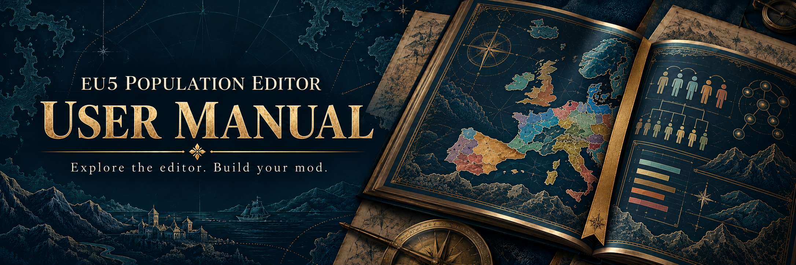

# EU5 Population Editor Manual

The guide to [EU5 Population Editor](https://github.com/Davoda1/EU5-Population-Editor): an offline Windows and GNU/Linux application for inspecting population data, reviewing demographic changes, and exporting separate Europa Universalis V mods.

**[Read the manual](https://davoda1.github.io/EU5-Population-Editor-Manual/)** · **[Build the manual](#build-the-manual)** · **[Get the editor](https://github.com/Davoda1/EU5-Population-Editor/releases)** · **[Report a documentation issue](https://github.com/Davoda1/EU5-Population-Editor-Manual/issues)**

This manual covers **application 1.0.3**. Its established **EU5 v1.4.5** compatibility baseline comes from earlier maintainer verification; it does not represent a new in-game compatibility test of 1.0.3. The initial supported-game-version setting remains **1.4.5** and can be changed for each installation. Later game versions require separate compatibility verification.

## Topics covered

| Topic | Chapters |
| --- | --- |
| Get started | Installation · Your first project |
| Explore the world | Countries, locations and maps |
| Change population data | Draft and Apply · Ratios and totals |
| Keep your work | Save and reopen projects |
| Handle game updates | Project migration · Import existing edits |
| Prepare a mod | Validation and reports · Export a mod |
| Look up details | Settings and shortcuts · Troubleshooting · Privacy and licensing |

Browse the [chapter source files](content/) or build the website below for the complete reading experience.

The built website adds chapter navigation, an on-page contents list, browser search, and light, dark and system themes. Screenshots follow the selected theme and can be opened at full size. All assets are local; search also works when the manual is opened from disk. The application bundles its matching edition and opens it in a separate manual window whose theme follows the application's Appearance setting. The hosted website keeps its own theme selector. Bundled contents remain available offline even when the hosted manual moves to a later application version.

The 1.0.3 screenshots show the actual application with synthetic demonstration data, fictional countries and locations, and an illustrative map. They do not contain shipped EU5 game assets.

## Build the manual

Use Python 3.12 or later:

```sh
python -m pip install -r requirements.txt
python scripts/build.py
python scripts/check.py
python scripts/test_build.py
```

Open `dist/index.html` in a browser or serve `dist/` with a static web server. The build works at a domain root or a project subdirectory.

To generate the application's offline edition instead, run `python scripts/build.py --offline`, followed by `python scripts/check.py`. It contains the same chapters, assets and local search; it identifies the bundled edition and omits links to changing page-source files. Python and Markdown are build tools. Reading a generated manual needs neither of them nor an HTTP server.

The application repository contains a frozen copy of the editable manual source and generated offline site. Its bundle script records exact SHA-256 inventories and its normal build verifies them without fetching this repository or rebuilding the manual. See the application build documentation for refreshing that snapshot.

The **Build manual** workflow validates pushes and pull requests targeting `master` and produces a complete website artifact. See [Contributing](CONTRIBUTING.md) for editing and validation guidance, and [Deployment](docs/DEPLOYMENT.md) for hosting instructions.

## License

Original manual code and text are licensed under **AGPL-3.0-only**, copyright © 2026 davoda1. See [LICENSE.txt](LICENSE.txt) and [third-party notices](THIRD_PARTY_NOTICES.md).

EU5 Population Editor is an unofficial tool and is not affiliated with or endorsed by Paradox Interactive. Europa Universalis V, its trademarks and game content belong to their respective owners.
